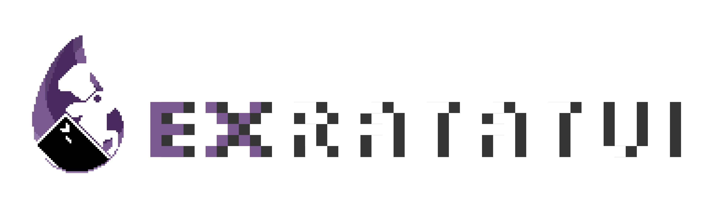

<p align="center">
  <a href="https://github.com/mcass19/ex_ratatui">
    
  </a>
</p>

<p align="center">
  Elixir bindings for the Rust <a href="https://ratatui.rs">ratatui</a> terminal UI library, via <a href="https://github.com/rustler-beam/rustler">Rustler</a> NIFs.<br />
  Build rich terminal UIs in Elixir with ratatui's layout engine, widget library, and styling system together with the BEAM superpowers.
</p>

<p align="center">
  <a href="https://hex.pm/packages/ex_ratatui"></a>
  <a href="https://hexdocs.pm/ex_ratatui"></a>
  <a href="https://github.com/mcass19/ex_ratatui/actions/workflows/ci.yml"></a>
  <a href="https://compatibility.nerves-project.org/packages/ex_ratatui"></a>
  <a href="https://github.com/mcass19/ex_ratatui/blob/main/LICENSE"></a>
</p>

---

## Features

- **25 built-in widgets** — from paragraphs, lists, and tables to charts, canvas, text inputs, markdown, syntax-highlighted code, images (Kitty, Sixel, iTerm2, halfblocks), and 3D viewports
- **Layout and styling** — ratatui's constraint-based layout, named, RGB, and indexed colors, and per-span rich text
- **Two OTP runtimes** — LiveView-style callbacks or an Elm-style reducer with commands and subscriptions, with apps written in Elixir, Erlang, or Gleam
- **Serve it anywhere** — the same app module runs in a local terminal, over SSH, over Erlang distribution, or on non-terminal surfaces like LiveView and pixel displays
- **Full input** — keyboard, mouse, resize, focus, and paste events, plus a focus ring for multi-panel apps
- **Custom widgets in pure Elixir** — compose primitives through a protocol, no Rust required
- **Testable and observable** — a headless test terminal, event injection, and `:telemetry` events throughout
- **No Rust toolchain needed** — precompiled NIFs, with event polling on DirtyIo schedulers so the BEAM never blocks
- **Single-binary distribution** — ship one native executable per OS/arch via [Burrito](https://github.com/burrito-elixir/burrito), scaffolded by `mix ex_ratatui.gen.burrito`

## Installation

Add `ex_ratatui` to the dependencies in `mix.exs`:

```elixir
def deps do
  [
    {:ex_ratatui, "~> 0.20"}
  ]
end
```

The first compile downloads a precompiled NIF for the host, so no Rust toolchain is needed. Requirements, supported platforms, and building from source are in the [Installation guide](guides/introduction/installation.md).

## Quick Start

```elixir
alias ExRatatui.Layout.Rect
alias ExRatatui.Style
alias ExRatatui.Widgets.{Block, Paragraph}

ExRatatui.run(fn terminal ->
  {w, h} = ExRatatui.terminal_size()

  paragraph = %Paragraph{
    text: "Hello from ExRatatui!\n\nPress any key to exit.",
    style: %Style{fg: :green, modifiers: [:bold]},
    alignment: :center,
    block: %Block{
      title: " Hello World ",
      borders: [:all],
      border_type: :rounded,
      border_style: %Style{fg: :cyan}
    }
  }

  ExRatatui.draw(terminal, [{paragraph, %Rect{x: 0, y: 0, width: w, height: h}}])

  # Wait for a keypress, then exit
  ExRatatui.poll_event(60_000)
end)
```

Try the [examples catalog](examples/README.md) for more — every widget has a focused, copyable demo, e.g. `mix run examples/basics/hello_world.exs`.

New here? The [Getting Started](guides/introduction/getting_started.md) guide builds a supervised todo app from `mix new` to a working TUI.

## Guides

The guides follow the groups in the docs sidebar. Every runtime works with every transport, and switching transport doesn't change the app module.

- **Introduction:** [Getting Started](guides/introduction/getting_started.md) builds a supervised todo app from `mix new` and is the place to start. Also [Installation](guides/introduction/installation.md), the [examples catalog](examples/README.md), and [Built with ExRatatui](guides/introduction/built_with.md).
- **Building UIs:** [Building UIs](guides/core/building_uis.md) covers widgets, layout, styles, rich text, and events. Then [custom widgets](guides/core/custom_widgets.md), [images](guides/core/images.md), [3D rendering](guides/core/3d.md), and [paste and clipboard](guides/core/paste_and_clipboard.md).
- **Runtimes:** the [Callback Runtime](guides/runtimes/callback_runtime.md) (LiveView-style `mount`/`render`/`handle_event`, the default) and the [Reducer Runtime](guides/runtimes/reducer_runtime.md) (Elm-style `update/2` with commands and subscriptions), compared [side by side](guides/runtimes/callback_runtime.md#callback-or-reducer). Also [state machine patterns](guides/runtimes/state_machines.md) and apps written in [Erlang and Gleam](guides/runtimes/erlang_and_gleam.md).
- **Transports:** the local terminal by default, or [SSH](guides/transports/ssh_transport.md), [a remote IEx shell](guides/transports/iex_shell_transport.md), [Erlang distribution](guides/transports/distributed_transport.md), [custom transports](guides/transports/custom_transports.md), and [non-terminal surfaces](guides/transports/cell_session.md), including [pixel displays](guides/transports/framebuffer_surfaces.md) through [raster_ex_ratatui](https://github.com/mcass19/raster_ex_ratatui). The [Transports guide](guides/transports/transports.md) has the feature matrix.
- **Going deeper:** [Architecture](guides/internals/architecture.md), [Testing](guides/internals/testing.md), [Debugging](guides/internals/debugging.md), [Performance](guides/internals/performance.md), and [Telemetry](guides/internals/telemetry.md).
- **Packaging:** single-file native binaries with [Burrito](guides/packaging/packaging_with_burrito.md).
- **Cheatsheets:** the [widgets cheatsheet](guides/cheatsheets/widgets.cheatmd), every struct with its key fields.

## How It Works

ExRatatui bridges Elixir and Rust through [Rustler](https://github.com/rustler-beam/rustler) NIFs: widget structs are encoded across the NIF boundary and decoded into ratatui types for rendering, while terminal events are polled on BEAM's DirtyIo scheduler so nothing blocks Elixir processes. Every transport builds on the same supervised `Server` process, with full session isolation per connected client.

The [Architecture guide](guides/internals/architecture.md) has the full picture — the NIF bridge and the per-transport process trees.

## Ecosystem

- [kino_ex_ratatui](https://github.com/mcass19/kino_ex_ratatui) — Run TUIs inside [Livebook](https://livebook.dev) notebooks.
- [phoenix_ex_ratatui](https://github.com/mcass19/phoenix_ex_ratatui) — Run TUIs in the browser within [Phoenix LiveView](https://phoenix-live-view.hexdocs.pm/Phoenix.LiveView.html).
- [raster_ex_ratatui](https://github.com/mcass19/raster_ex_ratatui) — Run TUIs on pixel displays such as e-ink panels, with helpers for Linux framebuffers.

## Built with ExRatatui

[Built with ExRatatui](guides/introduction/built_with.md) lists apps that use it, from Ash and robotics explorers to system monitors and coding agents. Yours? Open a PR.

## Contributing

Contributions are welcome! See [CONTRIBUTING.md](https://github.com/mcass19/ex_ratatui/blob/main/CONTRIBUTING.md) for development setup and PR guidelines.

## Acknowledgements

ExRatatui is undeniably inspired by [ratatui](https://github.com/ratatui/ratatui). Having such a great terminal UI library in Rust was the motivation to bring the same experience to the Elixir world and combine the best of both worlds. Special thanks to the great community behind ratatui.

The ExRatatui logo adapts the ratatui logo designed by [Pavel Fomchenkov](https://github.com/nawok), with the Elixir drop and ex_ratatui wordmark added by [Malena Merlina](https://www.linkedin.com/in/malenamerlinadiez).

## License

MIT — see [LICENSE](https://github.com/mcass19/ex_ratatui/blob/main/LICENSE) for details.
